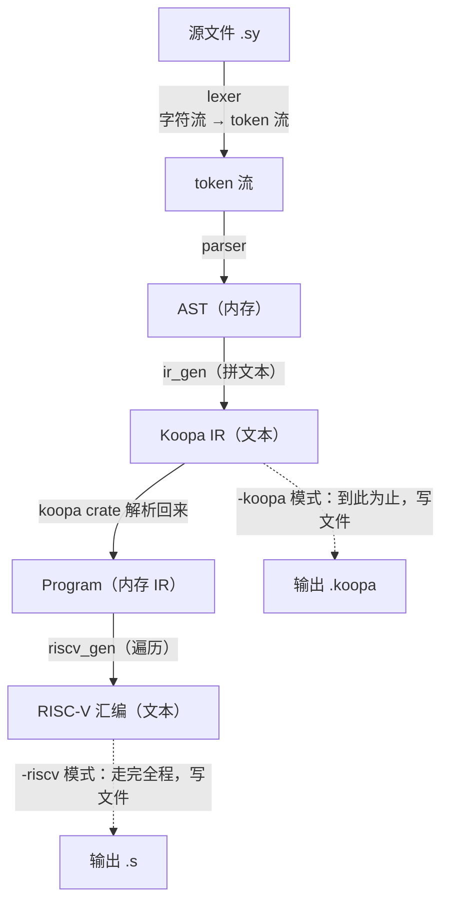
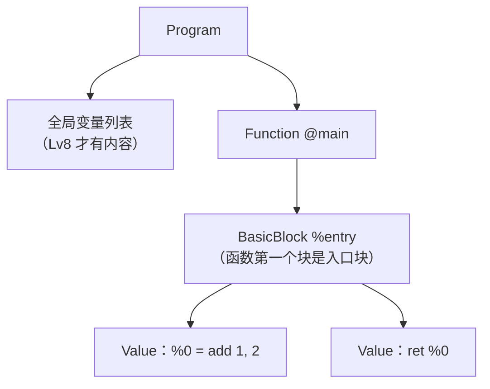
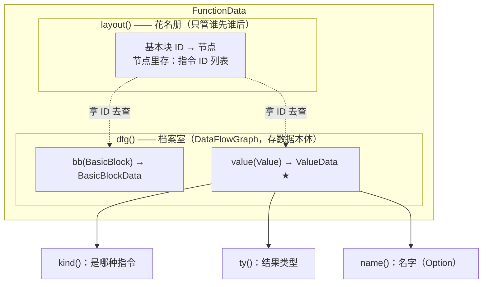
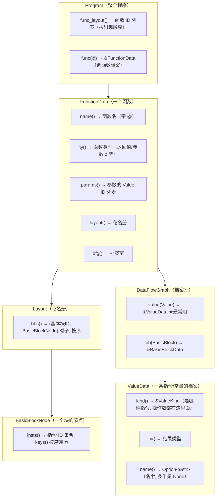

# Koopa IR / koopa crate 手册

> 本项目的后端 (`src/riscv_gen.rs`) 依赖官方 `koopa` crate。这份文档讲三件事：
> **它的设计思想**、**数据结构长什么样**、**日常怎么用**。
> 版本基准：`koopa = "0.0.10"`（Cargo.toml）。带 ✅ 标记的 API 是本仓库代码实测通过的；
> 其余以本地文档为准（`cargo doc --open -p koopa`）。

---

## 1. koopa 在我们的编译器里处于什么位置

koopa 是北大编译实践配套的官方库，核心能力一句话：**Koopa IR 文本 ⇄ 内存数据结构的双向转换**，外加内存结构的遍历接口。

我们编译器的完整流水线：



**为什么要"拼出文本再解析回来"绕一圈？** 生成汇编需要按类型取数据，文本没有结构，自己解析等于重写一个前端。koopa 就是现成的 IR 解析器。同时 IR 是前后端之间的检查站：线上 WA 时先看 `-koopa` 输出的 IR 对不对，IR 对则病在后端，IR 错则病在前端，调试范围减半。

---

## 2. Koopa IR 程序的结构

一个 Koopa IR 程序分四层，函数体里的指令必须预先按基本块组织：



**基本块（basic block）的规矩**：只能从头进、从尾出——跳转只能跳到某块开头，只有块的最后一条指令能转移控制流（`br`/`jump`/`ret`）。

**命名规矩**（文本形式里）：`@xx` = 具名符号（源程序里的函数/全局变量）；`%xx` = 临时符号（编译器生成的基本块名、指令编号）。所有值都有类型（前期只有 `i32`）。

---

## 3. 核心设计：ID（门牌号）与数据（档案室）分离

这是理解 koopa API 的**钥匙**。内存结构里，函数/基本块/指令/常量都只有一个小 ID（`Function` / `BasicBlock` / `Value`，本质是编号），ID 本身不含内容。真正的数据存在"档案室"里，拿 ID 去查：



- **谁先谁后**（顺序信息）在 layout 里，存的全是 ID；
- **数据本体**（指令种类、操作数、类型）在 dfg 里，拿 ID 查。

类比：C 里指针和指针指向的内存；我们 parser 里 `tokens: &[Token]` 配 `pos` 下标。

**为什么不用指针/引用直接互指？** IR 里指令会互相引用（`add %1, %2` 引用了两条指令的结果），Rust 的所有权系统不允许这种互相指的网状结构，用 ID（编号）就绕开了。

---

## 4. 内部结构地图：每一层里到底有什么

写后端就是在这几个结构里找东西。先把每层的"内部构成"摆清楚：



**两个档案室，别查错门**：

- 指令、常量、基本块的 id → 在 **函数内部** 查（`func.dfg()`）；
- 函数的 id（比如 `call` 的 `callee()`）→ 在 **Program 层** 查（`program.func()`）。

---

## 5. 数据访问手册：我想要 X，从哪拿

下面假定遍历中已经有 `program: &Program`、`func: &FunctionData`、
`inst: &ValueData`（当前指令的档案）、`inst_id: Value`（当前指令的 id）。

### 5.1 速查表

| 我想要…… | 访问路径 | 拿到什么 |
|---|---|---|
| 所有函数（按序） | `program.func_layout()` ✅ | `&[Function]`（id 列表） |
| 某函数的档案 | `program.func(func_id)` ✅ | `&FunctionData` |
| 函数名 | `func.name()` ✅ | `"@main"`（**带 @，进汇编前剥掉**） |
| 函数返回/参数类型 | `func.ty()` | `Type` |
| 函数参数列表 | `func.params()` | `&[Value]`（每个是 FuncArgRef） |
| 所有基本块（按序） | `func.layout().bbs()` ✅ | `(&BasicBlock, &BasicBlockNode)` 对子 |
| 基本块的名字 | `func.dfg().bb(bb_id).name()` | `Option<&str>`，如 `Some("%entry")` |
| 块内所有指令（按序） | `node.insts().keys()` ✅ | `&Value`（指令 id） |
| 一条指令的档案 | `func.dfg().value(inst_id)` ✅ | `&ValueData` |
| 指令是哪种 | `inst.kind()` ✅ | `&ValueKind`（match 它） |
| 指令结果的类型 | `inst.ty()` | `Type`（ret/store/jump 无结果） |
| 指令的名字 | `inst.name()` | 多半 `None`，编号自己维护 |
| **ret 的返回值** | `Return(r)` → `r.value()` ✅ | `Option<Value>`，再 dfg 查 |
| **常量的数值** | `Integer(i)` → `i.value()` ✅ | `i32` |
| **运算的种类** | `Binary(b)` → `b.op()` | `BinaryOp` |
| **运算的左右操作数** | `b.lhs()` / `b.rhs()` | `Value`（id，再 dfg 查） |
| 变量内存的地址 | `Alloc` 指令**自身的 id** | 即 `inst_id`，不用掏 |
| load 从哪读 | `Load(l)` → `l.src()` | `Value`（alloc 的 id） |
| store 存什么/存到哪 | `Store(s)` → `s.value()` / `s.dest()` | 两个 `Value` |
| 条件跳的条件/两个目标 | `Branch(b)` → `b.cond()` / `b.true_bb()` / `b.false_bb()` | 条件 `Value` + 两个 `BasicBlock` |
| 无条件跳的目标 | `Jump(j)` → `j.target()` | `BasicBlock` |
| 被调用的函数 | `Call(c)` → `c.callee()` → `program.func(...)` | 函数 id → 函数档案 |
| 调用的实参 | `c.args()` | `&[Value]`，按顺序 |
| 函数参数是第几个 | `FuncArgRef(a)` → `a.index()` | `usize` |

### 5.2 通用套路：所有"拿数据"都是同一条链

不管要什么，都是三步：

```rust
// 第 1 步: 从指令的 kind() 里掏出"操作数的 id"
//   —— 每种指令的掏法见 5.1 表 (ret.value() / bin.lhs() / load.src() ...)
// 第 2 步: 拿 id 去 dfg 查档案
// 第 3 步: match 档案的 kind(), 取出最终数据
```

**演练**：`%1 = add %0, 2` 这条指令，我想知道"右操作数是几"——

```rust
// inst = add 指令的档案
if let ValueKind::Binary(bin) = inst.kind() {
    // 第 1 步: 掏右操作数的 id. 注意! 拿到的是 id, 不是数值
    let rhs_id = bin.rhs();

    // 第 2 步: 查档案
    let rhs_data = func.dfg().value(rhs_id);

    // 第 3 步: 分派 —— 操作数有两种可能, 都要准备好接住:
    match rhs_data.kind() {
        // 情况 A: 是个常量 —— 本例走这里, 取出 2
        ValueKind::Integer(int) => { let n = int.value(); /* n == 2 */ }
        // 情况 B: 是另一条指令的结果(比如 %0 是条 mul) —— 递归同样处理
        other => { /* 指令结果, 后端该去"指令id↔寄存器"对照表查 */ }
    }
}
```

**演练**：`ret %1` 后面跟的不是常量而是指令结果，完整链条——

```rust
if let ValueKind::Return(ret) = inst.kind() {
    let Some(val_id) = ret.value() else { /* 裸 ret(void) */ return; };
    match func.dfg().value(val_id).kind() {
        ValueKind::Integer(int) => { /* 常量: li a0, int.value() */ }
        _ => { /* 指令结果: mv a0, <存 %1 的寄存器> */ }
    }
    // ret 指令本身无条件输出 "  ret"
}
```

**演练**：`jump %end` 的目标块叫什么名字（生成汇编标签用）——

```rust
if let ValueKind::Jump(jp) = inst.kind() {
    let target_bb = jp.target();                       // 基本块 id
    let name = func.dfg().bb(target_bb).name();        // Option<&str>
    // 自己拼文本时没起名就是 None → 后端给每个块分配标签名(如 .L0 .L1)
}
```

### 5.3 三条铁律（都是踩过的坑）

1. **常量不是指令。** `Integer` 不会出现在 `insts()` 队列里，只能作为操作数被掏出来。等它自己进 for 循环是等不到的（Lv2 实测）。
2. **每条 IR 指令都要恰好生成对应汇编。** 比如 `ret` 必须无条件输出——操作数是`None` 就输出裸 `ret`（Lv2 实测）。
3. **符号名带前缀。** `func.name()` 是 `"@main"`；`@` 在 RISC-V 汇编里是注释符，进汇编前必须 `trim_start_matches('@')`（Lv2 实测，不剥会让 `.globl` 失效 → AE）。

---

## 6. 排错套路

| 症状 | 病因方向 |
|---|---|
| `generate_program()` 报错 | 我们拼的 IR 文本不合法，错误信息带位置 |
| `unreachable!()` 命中 | 这一级文法引入了新指令，后端还没写对应分支 |
| 测评 AE（Assemble Error） | 生成的汇编不合法（`@` 没剥、`ret` 带参数这类） |
| 测评 WA | 汇编合法但语义错；先 `-koopa` 看 IR，定位前端还是后端 |
| 测评 CTE | 编译器自己编译测试用例时崩了（多半是 panic，如 lexer 遇到没处理的字符） |

---

## 7. 版本

- 以 `Cargo.toml` 里 `koopa` 的实际版本为准。
- 方法名如果和本文档对不上，跑 `cargo doc --open -p koopa` 在本地文档里搜等价物。
- **思想（ID ↔ 数据分离、layout/dfg 分工）不会变，变的只会是方法名。**